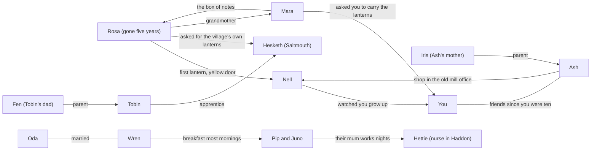

# Characters

Everyone in the village has their own worries. Nobody exists to teach the player a lesson.

## How they look

Round, plush animals (`src/ui/plush.ts`): You choose your own look (see below), Mara a deer, Tobin an otter,
Wren a goat, Oda a badger, Pip and Juno mice (Juno has a bow), Nell a sheep, Ash a bear. From
chapter four: Iris (Ash's mother) a greyer bear in a plum coat, pearls and a small hat; Fen
(Tobin's dad) an older otter in a yellow sou'wester and oilskin; Hesketh a white-grey hare with
long drooping ears, round glasses and a cardigan; Hettie (Pip and Juno's mum) a mouse in a
navy nurse's cape and white cap. Each
has their own face (eyes, brows, mouth, head shape) that fits who they are, and keeps their
outfit colors and props (Mara's clipboard and scarf, Tobin's cap and apron, Wren's baker's
hat, Nell's shawl, cane and flower, Ash's glasses).

**You.** Picked on the first new game and changeable from the title screen (`src/ui/wardrobe.ts`):
girl or boy (girl has short lashes and rounder cheeks), and a red panda, fox, cat, bunny, raccoon
or koala, in three fur colors each. Outfits (tunic and satchel, dress, overalls, striped sweater,
hoodie) come in six colors; add a hat (bow, flower crown, beanie, sun hat) and one extra (glasses,
scarf, bow tie). Every outfit works with either body; each body only starts in its own outfit.
No villager is a fox, cat, bunny, raccoon or koala, so you stand out.

**Feelings.** Eleven, each changing eyes, brows, mouth and cheeks, adding a small sign by the
head, and moving the body: calm (breathing), happy (sparkles, a bounce), laughing (a wobble),
warm, surprised ("!", a hop), worried (a sweat drop, a sway), sad (a tear, a sink), upset (a
puff of steam, a stomp), scared (a sweat drop, a shiver), embarrassed (blush lines, eyes down,
shrinking smaller), tired ("zzz", a droop). While someone speaks, their mouth opens and closes
with the words, in the village and in their portrait; everyone blinks.

## Rules for writing dialogue

- **No lectures:** no character explains a skill or tells the player what they should have done.
- **Costs come from people's own lives:** Mara thinks *she* upset you; Tobin thinks his laugh drove you
  off. Nobody blames or shames the player.
- **Characters notice different things:** most of them missed the fall entirely. That is what the
  facts are made of.
- **Speaking lines** are written in Ink as `id: text` or `id/feeling: text`. Feelings:
  `neutral`, `happy`, `laughing`, `warm`, `surprised`, `worried`, `sad`, `upset`, `scared`,
  `embarrassed`, `tired` (the older `smile` and `laugh` still work).

## The square

**Mara** (`mara`): runs the festival. Thirties, scarf, clipboard energy. Kind, organized, a worrier.
When things go quiet she assumes she caused it, which is the player's pattern seen from the outside.
Her grandmother started the festival, and her grandmother's paper lantern is the oldest thing Mara
owns. Says "okay, okay" when stressed.

**Tobin** (`tobin`): the lantern-maker's apprentice, early twenties, cap and apron full of wire.
Laughs when nervous or surprised, never to be cruel. He tripped on the same loose stone this
morning, broke one of his own lanterns, and has been joking about it all day so nobody else can
first. The one laugh the player hears is his.

**Wren and Oda** (`wren`, `oda`): the bakers, married, fifties. Wren (tall, baker's hat) frets
that the bread won't be ready by sundown. Oda (short, flour on everything) says it always is. They
bicker fondly and notice almost nothing outside their oven.

**Pip and Juno** (`pip`, `juno`): siblings, about seven and nine. Pip is delighted by everything;
Juno counts things and corrects people kindly. They think the red lantern rolling across the
square was the best thing that happened all day.

## Your lane

**Nell** (`nell`): the neighbor on your lane, in her eighties, shawl and cane, always on her step.
Has watched sixty-one festivals. Dry humor. Doesn't give advice; tells a story instead, usually
one where she was the one who got it wrong. Notices when the lane goes dark and isn't worried
by it.

**Ash** (`ash`): your friend, runs the tea cart, glasses and a long scarf. Steady and doesn't
push. If you hide, Ash comes up the hill, calls into the hollow once, and leaves tea on the
rock. Ash treats rest as allowed and is still glad when you come back.

## Who you can talk to, and when

| When | Who | What changes |
|---|---|---|
| Afternoon, before the fall | Nell (lane), Ash and the bakers (street), Tobin (inside the workshop), Mara and the kids (square) | Sets up who people are. Tobin mentions his own fall. |
| Night, if you hid | Ash at the hollow; Mara and Tobin overheard | Ash checks on you; Mara and Tobin each think it was their fault. |
| Finding out what happened | Tobin, the bakers, the kids, plus Nell (if you hid; behind the dark lane) or Ash (if you stayed) | Each conversation is a fact: Tobin fell too, the bakers didn't see, the kids watched the lantern, Mara was worried. Ash gives you a candle if you hid. |
| Festival evening | Everyone | Reactions depend on what you did and how fully you did it. |
| Chapter two, the morning after | The bakers, Mara and Tobin ask for help; Nell, Ash and the kids | Each errand wears you down. Everyone takes "no" well. Ash offers to cover your stall; telling Ash or Mara before resting is how resting works. |
| Chapter three, the storm | Pip (scared), Mara, Tobin, Nell, Ash | Pip panics too; once you're calm you can breathe with her. Mara asks for help tying the lanterns down. |
| Chapter four, opening day | Morning: Ash, Tobin (by the wheel), Nell (at her old desk), then Iris. Evening party: everyone | Ash asks for every morning; how you answer shows on the chalkboard. Ash tells Iris they're staying. |
| Chapter five, the first snow | Evening: Oda and the kids at your door, Nell through her door. Night: Pip and Juno, inside. Dawn: Hettie, the kids, Nell, Oda | Pip asks if her mum is stuck forever. How you spent the night shows on the window and in what the kids tell Hettie. |
| Chapter six, the tide | Fen and Tobin on the quay, Hesketh at his shed; at dusk, all three by the harbour wall | Saving things from the tide, then whether anyone can say "it's gone." Fen stops joking. |

## Conversations

Talking to someone opens a menu of topics you can come back to (`talk_*` knots at the end of
`story/festival.ink`). Topics change with the part of the story (`phase`: afternoon, finding out
what happened, festival, the morning after, after the storm) and open up as you learn things.
The conversations the story depends on (finding out what happened, the morning errands,
telling someone you're resting) are topics too. A bright, bobbing speech bubble means someone
you haven't talked to yet in this part of the story; a faint one means you have, and can again.

## Their own stories

Each villager's story runs quietly through all three chapters. None of them is a lesson; they
mirror the player's situation from the outside.

| Who | Their story | What they remember |
|---|---|---|
| Tobin | Fell on the same stone that morning. Laughs first so nobody can laugh at him, a habit from his dad. In chapter two Pip is acting out his fall for everyone; you can tell him you wanted to vanish too. Hesketh has offered him the workshop and he hasn't answered; after the storm he says yes. He fixes the stone. | Whether you laughed with him, were kind ("that sounds rough"), or said nothing; whether you told him about your own fall; whether he told you about Hesketh's offer. |
| Mara | Her grandmother Rosa started the festival 61 years ago with one lantern on her step. When things go quiet she assumes it's her fault. Overcommits; in chapter two, if you're resting, you can suggest she does too. Freezes in the storm. After it, she can open Rosa's box of notes with you and find out who the first lantern was for. | Whether you heard about her grandmother; whether she took an hour off; whether you opened the box together. |
| Wren and Oda | Wren's back hurts and she won't say so; Oda knows, and has been secretly getting up an hour early for a year to do Wren's kneading. By the storm, Wren asks for help out loud. If you noticed Oda's tiredness, Wren finds out after the storm. | Whether you noticed Wren's back; whether you carried the bread trays; whether you noticed Oda's tiredness. |
| Pip and Juno | Their mum works nights as a nurse, so the bakers mind them. Pip wants to stay up all night and is scared in the storm. Juno counts things (412 cobblestones, 73 flags) when it's loud: "It gives the noise somewhere to go." She started counting when their mum first went on nights. | Whether you helped Pip breathe; whether you know about Juno's counting. |
| Nell | One winter, after losing her husband and then her place at the mill, she didn't come out till spring. When she did, someone had painted her door yellow. Nobody owned up. If you've heard her story and opened Rosa's box with Mara, you can tell her the first lantern was for her. | What you told her ("Not me. Not today."); whether you heard about the door; whether you told her what Rosa wrote. |
| Ash | Wants to open a tea shop in the old mill office and is scared nobody will come. Signs the lease in chapter two, opens next week. Has known about your hollow since you were both ten. | How you reacted (encouraged, joked, or asked what scared them). |

## Full backstories

This is the background the dialogue is written from. Most of it never appears on screen; the
parts that do are marked **On screen**. Write new lines so they could be true of the person
below, and never use a backstory to explain a skill or to make the player feel they caused
someone's trouble.

### The village

| Years ago | What happened |
|---|---|
| About 70 | Rosa and Nell, both girls, grow up across Lantern Lane from each other. |
| 63 | Nell marries Wil. Both work at the mill. |
| 61, autumn | Wil dies of a fever. In November the mill shuts and half the village loses its work. |
| 61, winter | Nell stops coming out, and keeps her curtains closed. Rosa starts setting a lantern on her own step every night, where Nell's window can see it. Neighbors ask, then copy her: first the lane, then the square. That is the first festival. |
| 60, April | Rosa paints Nell's door yellow while Nell is still inside. Neither of them ever mentions it. |
| 40 | Hesketh opens the lantern workshop on Market Street, so the village can stop buying lanterns from the city. |
| 25 | Oda's aunt Bet hands over the bakery. Wren arrives for one summer's work and stays. |
| About 20 | You move to Lantern Lane at eight, know nobody, and find the hollow. Ash, staying with their gran, finds you there two years later. |
| 20 | Wren and Oda marry. |
| About 10 | You move away for some years. |
| 6 | Tobin arrives at sixteen to apprentice with Hesketh. Ash takes over their gran's tea cart. |
| 5 | Rosa dies. Mara, who has lived with her for years, takes over the festival. |
| 2 | Hesketh retires to the coast, Tobin's home town. He writes long letters about glue. |
| Last spring | You come back. Wren's back starts to hurt; Oda starts getting up at three. |
| This week | The 62nd festival (Nell has watched 61 from her step, and this is the next). Mara asks you to carry the lanterns. |
| A week later | Chapter four: Ash opens Mae's in the old mill office. Iris comes from the city. |
| Two months later | Chapter five: the first snow. The Haddon road shuts with Hettie on the wrong side of it. |
| Early spring | Chapter six: the March storm has flooded Hesketh's shed in Saltmouth. You go with Tobin to save what's left. |

### You (red panda)

Kept loose on purpose, so any player can step in: no family details, no gender, no job.

- **History:** moved to Lantern Lane at eight, the new one who knew nobody. Found the hollow
  in the rocks the first month and went there whenever something went wrong. At ten, Ash
  found you there, sat outside without saying much, and waited until the tea went cold. You
  chipped Ash's gran's cup at twelve and cried for an hour.
- **The years away:** you left for some years and came back last spring. This is your first
  festival back. Carrying the lanterns is the first job anyone has given you since; it means
  you belong here again, which is why dropping them lands so hard.
- **What people know:** Nell has always known where you went (**On screen**, afternoon: "I
  always knew where you'd gone"). Ash knows about the hollow and comes to it (**On screen**,
  if you hid). Mara asked you because you came back (**On screen**, afternoon).

### Mara (deer)

- **Family:** Rosa's granddaughter. Spent summers in Rosa's house on Lantern Lane as a child
  and moved in at twenty when Rosa needed help. Her mother lives in the city and visits at
  New Year. Mara still lives in Rosa's house; the supper invitations are for there.
- **The festival:** took it over at twenty-nine, when Rosa died. Rosa never used a list; Mara
  has eleven. The lists are how she keeps the fear of doing it wrong somewhere she can see it.
- **What she fears:** being the one who lets the festival fade. Underneath that: that people
  were only ever kind to her because of Rosa. That's why her first guess, when anything goes
  quiet, is that she caused it.
- **What she wants:** one festival where nothing goes wrong. She finds out it never happened,
  even for Rosa.
- **The box:** a shoebox in the attic marked FESTIVAL, untouched for five years. Inside, sixty
  years of pencil notes, almost all of them mistakes ("Year three. Forgot the candles. Used
  turnips."). At the bottom, the oldest note: the first lantern was for Nell, and Rosa painted
  her door. **On screen**, after the storm, if you heard how the festival started.
- **Habits:** says "okay, okay" when stressed; walks the same loop of the square when
  thinking; keeps Rosa's lantern on the top shelf, away from everything.

### Tobin (otter)

- **Family:** from a fishing town on the coast. His dad, Fen, jokes through everything,
  including the years the boats came back empty. Tobin loves him, and is slowly working out
  which jokes help and which ones hide things. His mum is quiet and sends knitted socks.
- **The workshop:** came at sixteen to apprentice with Hesketh, who retired to the coast two
  years ago and writes long letters about glue. Tobin made eleven of this year's lanterns;
  the red one is the first he designed himself, and it's a little crooked (**On screen**,
  main story). Hesketh has offered him the workshop for good. He hasn't answered in three
  weeks, because an apprentice is allowed to get it wrong and an owner isn't. **On screen**:
  he tells you at the festival, and says yes after the storm.
- **What he fears:** being laughed at for really trying. So he laughs first.
- **Habits:** twists wire while he talks; counts things for Juno so she doesn't have to;
  says "Ha" after anything that matters.

### Wren (goat) and Oda (badger)

- **History:** the bakery was Oda's aunt Bet's. Wren came for one summer, twenty-five years
  ago, as seasonal help. She burned the first batch, Oda laughed, and Wren stayed. Married
  twenty years.
- **Wren:** tall, quick, a worrier about bread and nothing else out loud. Her back has hurt
  since last spring. She's afraid that slowing down means getting old, and that a slow bakery
  is a bakery people stop coming to.
- **Oda:** short, floury, unbothered. For a year she has been getting up at three instead of
  four to do Wren's share of the kneading before Wren comes down, and has never said so,
  because Wren would never have agreed. **On screen**: you notice she's tired in chapter two,
  and Wren finds out after the storm. They decide to hire help, out loud.
- **Pip and Juno:** the bakers give them breakfast most mornings and mind them during the
  festival.

### Pip and Juno (mice)

- **Family:** their mum is a nurse at the infirmary in Haddon, the next town, and works
  nights, so she sleeps in the day (**On screen**, chapter two). Nobody else in their family
  is mentioned; don't add anyone.
- **Juno (nine):** started counting things when their mum first went on nights, counting the
  days to Saturday. Now she counts whenever it's loud: 412 cobblestones, 73 flags. She
  corrects people kindly and is quietly in charge of Pip.
- **Pip (seven):** has decided this is the year she's big enough to stay up all night. Named
  Tobin's red lantern Strawberry ("It's a strawberry in its heart"). The storm is her first time
  being really scared in front of everyone.

### Nell (sheep)

- **History:** eighty-four. Grew up across the lane from Rosa; they were girls together.
  Married Wil at twenty-one; both worked at the mill. Wil died of a fever the autumn she was
  twenty-three, and in November the mill shut. That winter she couldn't face anybody and
  kept the curtains closed. She watched one light through them all winter: Rosa's lantern on
  Rosa's step. She thought Rosa had just taken to sitting out.
- **The door:** in April she opened the door and it was yellow. Nobody owned up. She has
  told people it was losing the mill; it was never the mill. **On screen**: the door story in
  the afternoon; if you open Rosa's box with Mara after the storm, you can tell Nell, and she
  says this herself.
- **The mill, and Wil:** she did the wages: a little brown envelope for every family, every
  Friday, so she knew what everyone earned, "which is why nobody ever argued with me." Wil
  worked the millstones and read to her out loud on snow nights. After he died, she did the
  wages in her head on long nights: "It gave the night somewhere to go." **On screen**,
  chapters four and five.
- **Who she is now:** has watched every festival from her step, without knowing they began
  for her. Dry, unhurried, notices everything. Doesn't give advice; tells stories where she
  got it wrong. After hearing the truth, she plans to take Mara something yellow.
- **Habits:** a flower in her shawl, always; counts festivals instead of birthdays.

### Ash (bear)

- **Family:** their parents run a tea company in the city with forty shops, and think the cart
  is a phase (six years so far). Ash spent their school years in the village with their gran,
  Mae, who ran the tea cart and taught you both to drink tea (**On screen**, festival).
- **You:** best friends since you were ten, when Ash found you in the hollow and sat outside.
  The chipped cup is the one you broke at twelve; Ash said it was their favorite so you'd stop
  crying, and then it was (**On screen**, afternoon). That is why, if you hide, Ash knows
  exactly where to go and what to do (**On screen**, the morning after you hide).
- **The shop:** wants to turn the old mill office, where Nell used to work, into a real tea
  shop with chairs. Signs the lease in chapter two; opens the week after the festival. Afraid
  it will be "just okay".
- **Who they are:** steady about other people's feelings and much less steady about their own;
  only admits being scared if you ask. Pronouns: they/them.
- **Opening day (chapter four):** the tea room is called Mae's, after their gran, who ran the
  cart for forty years "and never once had a chair" (now there are twenty-two, none
  matching). Ash panics and asks you to run the counter every morning. They've never once
  told their mother no in six years; with your help (or without it) they finally do.

### Iris (bear, from chapter four)

- **Who:** Ash's mother, about sixty, from the city. Runs the family tea company: forty shops.
  Polished, brisk, loves Ash, and has been calling the cart "a phase" for six years.
- **Her mother:** Mae, Ash's gran, ran the village tea cart for forty years. Iris spent all
  of them trying to get her to sell it. "Ash is so like her it frightens me a little."
- **On opening day:** comes to talk Ash out of it. Hears no, finally, says nothing for a long
  moment, and asks for a cup of the orange tea Ash calls Lantern. Stays for three pots. Calls
  it "rather good tea", which from her is a parade.

### Fen (otter, from chapter six)

- **Who:** Tobin's dad, a fisherman in Saltmouth, in his fifties. His boat is the Marigold,
  older than Tobin: "the only thing that's never once laughed at my jokes."
- **The empty years:** three winters the fish didn't come and they nearly lost the house. Fen
  joked about every bill; Tobin's mum did the crying for both of them. He knows that wasn't
  fair on her.
- **In chapter six:** jokes about the flooded shed until Tobin snaps at him. Then, for once,
  stops, says "I couldn't stand still in it," and says sorry. "Not great. Honestly. That's the
  first time I've said that in about thirty years."

### Hesketh (hare, from chapter six)

- **Who:** the old lantern-maker, eighty-six. Opened the workshop on Market Street forty years
  ago when Rosa asked him to give the village lanterns of its own; made every mould himself.
  Retired to Saltmouth two years ago, to a shed on the shingle where he kept the originals.
- **The sea:** he moved the moulds up a shelf in the autumn; the March storm came up two. He
  was angry for a week, "then angry at being angry, which is a waste of a good week." He
  says "it's gone" every time part of him says "but it shouldn't be," like leaning on a
  tiller: "you don't do it once."
- **Secrets:** Rosa made him promise not to tell anyone about the first lantern. He's glad
  someone else broke it: "I'm too old to break promises. I don't have the knees."

### Hettie (mouse, from chapter five)

- **Who:** Pip and Juno's mum, a nurse on nights at the infirmary in Haddon. Sings in the car,
  badly; does all the voices when she reads; smells of the hand soap at work.
- **The snow night:** stuck at the infirmary with her coat on, sitting by the door; every car
  she thought was the plough. She made tea for the night porter and did a crossword she
  already knew the answers to. Rides home at dawn in the plough, on a bag of grit.

## Passing remarks

One-liners villagers say as you walk by (`src/game/barks.ts`), different in each part of the
story. Under the shame haze, only people you've found out about make friendly remarks. Nobody
chats during the storm or on the night you hid.
